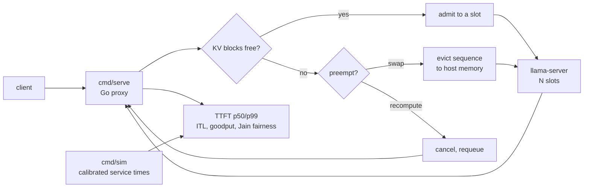

# kv-serving-scheduler

[](https://github.com/DrMkdaddy/kv-serving-scheduler/actions/workflows/test.yml)

A serving scheduler for llama.cpp with a hard KV-cache budget: continuous
batching, block allocation, admission control, preemption, and per-tenant
fairness. Measurements run to 120% of capacity on one 16 GB GPU.

The repo has two paths that share the same allocator and policy code:

- `cmd/serve`: a Go proxy in front of `llama-server`. It queues requests,
  admits them against a block budget, pins them to a server slot, streams the
  upstream response, and preempts (cancel + recompute) when the budget is
  exhausted.
- `cmd/sim`: a discrete-event simulator calibrated from measured llama.cpp
  service times. It is used for policy sweeps that the real server cannot
  expose: swap vs recompute preemption, fairness under overload, and KV
  fragmentation over time.



## What is measured

| Metric | Real proxy | Simulator |
|---|---|---|
| Throughput vs offered load | yes | yes |
| TTFT p50 / p99 | yes | yes |
| Inter-token latency p50 / p99 | yes | yes |
| KV blocks in use / free / internal waste | yes | yes |
| Preemptions per minute | yes | yes |
| Goodput under an SLO | yes | yes |
| Per-tenant Jain fairness | yes | yes |
| Swap vs recompute cost | no | yes |

## Quick start

```bash
# Unit tests, no GPU
go test ./...

# Calibrate service times from a running llama-server (or use the committed
# configs/qwen3-4b-calibrated.json)
./bench/calibrate.sh

# Policy sweep: FCFS, priority, WFQ at 80/100/120/150% of capacity
go run ./cmd/sim --config configs/qwen3-4b-calibrated.json --out results/sim.json

# Real proxy in front of llama-server
llama-server -m ... -c 8192 -np 4 -ngl 99 --metrics &
go run ./cmd/serve --config configs/qwen3-4b-real.json

# Load generator
go run ./cmd/loadgen --url http://127.0.0.1:8080 --rate 2 --duration 60s
```

Or:

```bash
./scripts/reproduce.sh
```

## Results

The committed runs are in [`results/`](results/). Every table in the writeup
is generated from those JSON files.

<!-- RESULTS:START -->
### Simulator: 4 slots, 8 blocks (2048 tokens), 200 requests

Source: `results/sim_20261101.json`. Calibration: `results/calibration.json`
(Qwen3-4B Q4_K_M, one RX 9070 XT, Vulkan).

| Scenario | Req/s | Tok/s | TTFT p50 | TTFT p99 | Preemptions | Goodput |
|---|---:|---:|---:|---:|---:|---:|
| FCFS 80% | 1.57 | 303 | 171 ms | 2604 ms | 78 | 91.0% |
| FCFS 100% | 1.88 | 362 | 1185 ms | 5463 ms | 142 | 66.5% |
| FCFS 120% | 1.89 | 364 | 4073 ms | 14410 ms | 157 | 24.0% |
| FCFS 150% | 1.88 | 360 | 6646 ms | 20045 ms | 157 | 11.0% |
| WFQ 120% | 1.85 | 357 | 4183 ms | 13202 ms | 166 | 25.5% |
| Swap 120% | 2.04 | 392 | 2782 ms | 8191 ms | 155 | 29.5% |
| No preemption 120% | 1.48 | 281 | 443 ms | 2440 ms | 0 | 59.5% |

At 120% load the system is still completing requests, but the p99 TTFT is
14.4 s and only 24% of offered requests meet both SLOs. Swapping instead of
recomputing buys 8% throughput and 5.5 points of goodput. Shedding keeps the
successful requests fast (p99 2.4 s) but fails 74 of 200; goodput counts those
failures.

### Per-tenant fairness under a skewed arrival mix

Tenant `a` offers 80% of the requests, tenant `b` 20%. Same 120% load.

| Policy | a p99 TTFT | b p99 TTFT | a preemptions | b preemptions | Goodput |
|---|---:|---:|---:|---:|---:|
| FCFS | 10.8 s | 10.1 s | 111 | 39 | 15.0% |
| Priority (b high) | 14.4 s | **1.17 s** | 95 | 58 | 22.5% |
| WFQ (equal weights) | 22.7 s | **1.34 s** | 105 | 40 | 26.5% |

The light tenant's p99 TTFT drops by about 9x under both policies; the heavy
tenant pays for it. Jain completion ratio stays near 1 because every request
completes, so per-tenant p99 is the useful comparison.

### Real proxy: llama-server behind `cmd/serve`

Source: `results/real_summary.json`. Four upstream slots, three logical KV
blocks, 128 generated tokens per request, 123-token prompt. The proxy streams
the upstream response internally to measure TTFT and ITL, then returns a
non-streaming response.

| Offered req/s | Completed | Tok/s | TTFT p50 | TTFT p99 | Wall p99 | Preemptions |
|---:|---:|---:|---:|---:|---:|---:|
| 1 | 19/19 | 122 | 53 ms | 55 ms | 949 ms | 0 |
| 2 | 39/39 | 210 | 1480 ms | 3115 ms | 4562 ms | 0 |
| 3 | 59/59 | 219 | 6301 ms | 8010 ms | 9602 ms | 0 |
| 4 | 79/79 | 218 | 7333 ms | 8866 ms | 10318 ms | 0 |

Mixed-priority run at 3 req/s low priority plus 0.5 req/s high priority:

| Tenant | Requests | TTFT p99 | Queue p99 | Preemptions |
|---|---:|---:|---:|---:|
| high | 14 | **74 ms** | 3 ms | 0 |
| low | 89 | 12212 ms | 12158 ms | 14 |

The real proxy tops out near 219 tok/s because it reserves 3 blocks and uses
the per-token SSE path to observe TTFT/ITL. The direct llama-server calibration
at 3 resident sequences is 359 tok/s. The simulator uses the direct curve, so
its absolute throughput is an upper bound.
<!-- RESULTS:END -->

## Design

The scheduler has four pieces:

1. **Block allocator.** KV memory is a fixed pool of `block_size`-token
   blocks. A sequence owns `ceil(tokens / block_size)` blocks. Allocation is
   atomic: if a grow fails, the sequence keeps its old blocks and the caller
   decides whether to preempt.
2. **Admission.** A request enters the queue with a prompt-token count and a
   maximum output length. It is admitted only when a slot is free and its
   initial prompt blocks fit. The queue has a hard limit; beyond it the proxy
   returns 429.
3. **Continuous batching.** The upstream llama-server already batches active
   slots. The proxy keeps every slot fed and measures the batch effect through
   llama-server's own counters. The simulator models the same effect with a
   measured `step_ms(n) = a + b*n` curve.
4. **Preemption.** When a grow fails, the scheduler selects a victim and
   either recomputes it later (free its blocks, requeue the full prefix) or
   swaps it (simulator only). The real proxy uses recompute because llama.cpp
   does not expose a portable per-sequence GPU-to-host KV swap over HTTP.

## Limits

- One GPU, one model. The real proxy runs on the same card as the model; the
  simulator is calibrated to that card and is not a claim about another one.
- The real proxy's block accounting is logical. llama.cpp owns the physical KV
  cache and allocates it up front from `-c` and `-np`; the proxy enforces a
  smaller budget so eviction is forced. This is admission control, not a
  paged-attention kernel.
- The real proxy preempts non-streaming requests transparently. Streaming
  clients cannot be restarted without duplicate tokens, so the proxy only
  preempts a streaming request before its first token.
- The simulator is for policy comparison under one calibration; its absolute
  numbers are not a substitute for the real run.

## Layout

```
cmd/serve       HTTP proxy with queue, slots, block budget, preemption
cmd/sim         discrete-event policy simulator
cmd/loadgen     open-loop load generator
internal/kv     block allocator and stats
internal/sched  admission, preemption, fairness, simulator
internal/proxy  real proxy and upstream client
configs/        calibration and deployment configs
bench/          calibration and real-run scripts
results/        committed JSON artifacts
docs/           design notes and measured writeup
```

## License

MIT.
